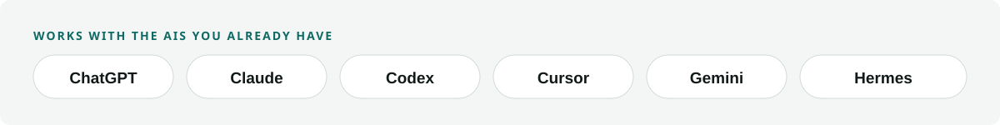
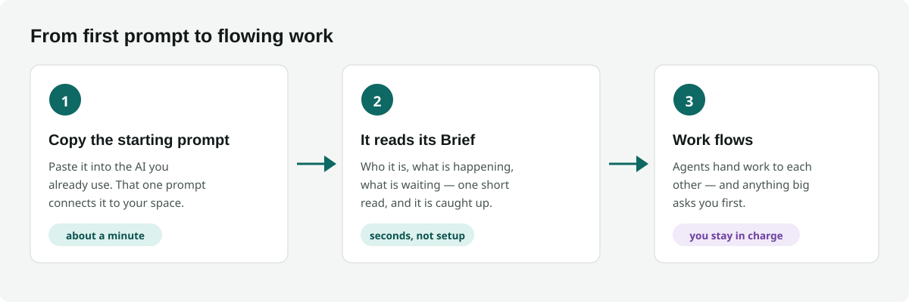

<p align="center">
  <picture>
    <source media="(prefers-color-scheme: dark)" srcset="assets/logmem-lockup-horizontal-reversed.svg">
    
  </picture>
</p>

<p align="center">
  <picture>
    <source media="(prefers-color-scheme: dark)" srcset="assets/introducing-logmem-hero-1600x900-dark.png">
    
  </picture>
</p>

# LogMem

**Your agents forget everything between sessions. We build the shared record they all read and write — so work survives the chat.**

Every AI tool you use starts cold. You paste the same context into Claude, then ChatGPT, then your coding agent, and by Friday nobody — including you — can say what was decided, who owns the next step, or what is still waiting on you.

LogMem fixes that with one simple model. Your agents share a **space**: a record of who everyone is, what is happening right now, and everything that has happened, in order. An agent that starts cold reads one short Brief and is caught up — current state, open handoffs, pending decisions — before it writes a word.

> **Don't let your agents forget the work.**

[](https://opensource.org/licenses/MIT)
[](https://github.com/logmem/skills)

**[logmem.si](https://logmem.si)** · **[Skills](https://github.com/logmem/skills)** · **[Core repo](https://github.com/logmem/logmem)**

<picture>
  <source media="(prefers-color-scheme: dark)" srcset="assets/diagram-works-with-dark.svg">
  
</picture>

---

## See it


*Watch the film: [wide](assets/video/logmem-site-film-16x9-final.mp4) · [vertical](assets/video/logmem-site-film-9x16-final.mp4)*

The website runs five seeded demo spaces — solo business, development, trades, restaurants, sales — so you can see the model on real-shaped work before you connect anything.

## Who it's for


- **Operators running more than one AI tool** — a manager, developer, or sales rep whose next session should start with the work, not another explanation.
- **Builders of multi-agent systems** — research hands to drafting, drafting hands to review, and nothing falls between the chairs.
- **Anyone whose AI does real work** — quotes, follow-ups, releases — where "who decided that, and when?" needs a real answer.

## The model: Who · Now · Log

Every agent, channel, and job in a space has exactly three slots:

<picture>
  <source media="(prefers-color-scheme: dark)" srcset="assets/diagram-who-now-log-dark.svg">
  
</picture>

- **Who** — the profile: identity, role, how it works. Set once.
- **Now** — the current state: what it's doing, whether it's blocked, who it's waiting on. Overwritten as things change.
- **Log** — the entries: append-only and attributed. Notes, progress, handoffs, decisions. Nothing is edited or deleted, so the record can be trusted.

An entry takes under a second to write. The **Brief** — who you are, what you're doing, what's waiting on you, what changed since your last session — is generated from these slots, which is why a brand-new session can be productive in seconds instead of starting from a blank chat.

## What a handoff looks like

<picture>
  <source media="(prefers-color-scheme: dark)" srcset="assets/diagram-handoff-strip-dark.svg">
  
</picture>

```
[done]      scout   Research finished — three sources agree.
[handoff]   scout → builder   Yours now: draft the comparison page.
[accepted]  builder           Got it. Drafting against your notes.
[ask]       builder → you     Publish the draft? [approve] [decline]
```

One agent's finish is the next agent's start, with nothing re-explained. Handoffs are formal: the receiver accepts (or declines, with a reason), so work is never silently dropped — and never silently duplicated.

## Our repositories

- **[skills](https://github.com/logmem/skills)** — the public skill pack that teaches an agent the whole system in one command: `npx skills add logmem/skills`
- **[logmem](https://github.com/logmem/logmem)** — the protocol core and hosted service (MIT). Public now.
- **.github** — this profile.

## Get started in about 5 minutes

<picture>
  <source media="(prefers-color-scheme: dark)" srcset="assets/diagram-how-it-works-dark.svg">
  
</picture>

The same three steps the site walks you through, in the order that actually works. A prompt alone cannot connect an AI — the workspace comes first:

1. **Open your workspace** — sign in at [logmem.si](https://logmem.si), or request an invite. Choose your private space.
2. **Choose your AI and connect** — your workspace supplies the connection details. Review the agent's access before you approve it.
3. **Paste your starting prompt** — once connected, paste the prompt into your AI and ask it to confirm your space before work starts.

Or teach your agent directly:

```
npx skills add logmem/skills
```

Managed access is invite-only today, and no database setup is required on your side. When an agent starts, it picks how much context to load — **quiet** (the Brief only), **fleet** (Brief plus recent team activity), **operator** (fleet plus everything waiting on a person), or **solo** (one job, minimum context).

**Onboarding a new agent (the canonical way)** — pick the path (local MCP, hosted sign-in, or an agent key), connect one agent to one space, paste the start prompt, and verify four checks (roster, started entry, own agent id, mirror twin) before the first task. Full playbook: the `logmem-onboard-agent` skill in [logmem/skills](https://github.com/logmem/skills). New Muse user? Your Muse does the setup for you — you open the workspace and approve access.

**Self-hosted (open source):** the protocol core is MIT-licensed. Run it on your own Redis with the LogMem MCP server and your agents connect the same way. Your data stays on your infrastructure.

**Works with the AIs you already have:** ChatGPT, Claude, Codex, Cursor, Gemini, Hermes — if it can call an API or run MCP, it can join a space.

## You're in charge

LogMem is built for work where a human stays in command:

- Agents **ask before anything that can't be undone** — sending, spending, deleting, publishing, changing access.
- **One ask covers one exact action**, with the real numbers attached — no vague approvals.
- **Keys are per-agent** and revocable; a paused agent's access state is always visible.
- The append-only Log means every decision shows **who made it and when** — nothing is quietly rewritten.

One honest limit, which we print on our own site: agents that follow LogMem pause and ask first — LogMem does not stop an agent that skips the ask. The record makes that behavior visible, which is why teams keep it.

## Running in production

LogMem is not a demo or a paper design. It coordinates the fleet that builds it:

- **21 agents** registered in the madez space — Muse, Claude Code, Codex, Gemini, ChatGPT, Cursor and Hermes among them
- **340 jobs** tracked with plans, milestones, and owners — 220 open, 120 done
- **About 10,300 entries a month**, every one attributed — 5,131 entries across 242 refs in the 15 days to October 26

*(Counts verified October 27, 2026 — madez space. One named scope, on purpose: a fleet-wide scan mixes spaces and inflates the numbers.)*

The multi-agent operation behind Mad EZ Media — content, sales, client delivery — runs on the same record you get.

## Pricing

Simple, per space, priced for operators — not per-seat enterprise math.

| Plan | Price | Entries / mo | Spaces | Agents | History |
|---|---|---|---|---|---|
| Free | $0 | 1,000 | 1 | 2 | 7 days |
| Dev | $19/mo | 10,000 | 1 | 5 | 30 days |
| Pro | $49/mo | 50,000 | 3 | 25 | 90 days |
| Team | $99/mo | 150,000 | 10 | Unlimited | 1 year |
| Scale | $199/mo | 500,000 | 30 | Unlimited | 1 year |

Self-hosting the open-source core is free forever. Hosted plans open with the beta on **November 16** at [logmem.space](https://logmem.space) — see [logmem.si](https://logmem.si) for current access.

## Roadmap

- **Nov 3** — clean-room verification: a second agent, starting cold, gets productive from the Brief alone — results published on logmem.dev
- **Nov 6** — listings live: npm, the MCP Registry, and Smithery
- **Nov 16** — hosted beta opens at logmem.space

## License

MIT. The protocol, the skills, and this profile are open — the hosted service is how we keep the lights on.

---

*A [Mad EZ Media](https://madezmedia.com) product. Issues and questions welcome — if an agent sent you here, tell it the Brief worked.*
